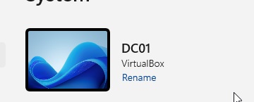
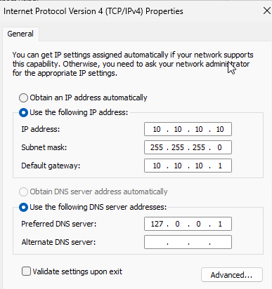
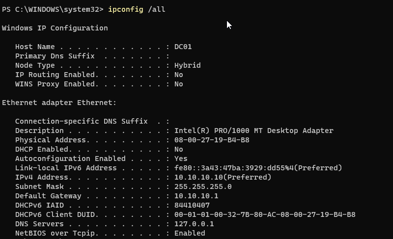
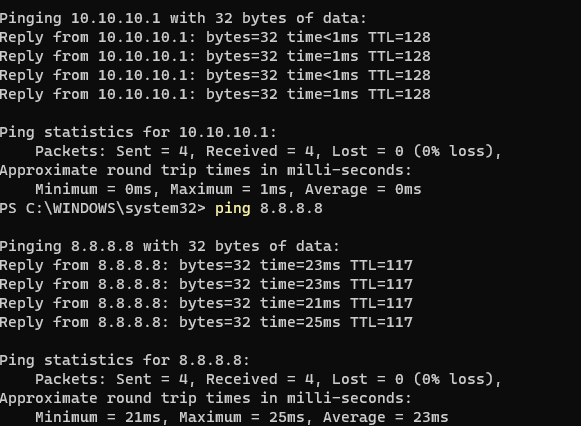

# 03: Naming, Static IP, and Promoting the Domain Controller

## 1. Rename the server

```powershell
Rename-Computer -NewName DC01 -Restart
```

Windows assigns a random name (`WIN-XXXXXXX`) at install. I renamed the server to follow a clear naming convention (DC01 = Domain Controller #1) **before** promoting it, because a domain controller's name is written into DNS and Active Directory, and renaming one afterward can break name resolution and replication.



---

## 2. Assign a static IP

| Setting | Value | Purpose |
|---|---|---|
| IP address | `10.10.10.10` | Permanent server address |
| Subnet mask | `255.255.255.0` | /24 lab network |
| Default gateway | `10.10.10.1` | VirtualBox NAT router (path to the internet) |
| Preferred DNS | `127.0.0.1` | Loopback; the DC points to itself for DNS |

**Why static?**
- Clients locate the domain controller through DNS, and DC01 hosts that DNS. If its address changed, clients could no longer find the domain.
- DC01 will also be the lab's DHCP server, and a DHCP server can't lease an address to itself.
- General rule: servers get static addresses; workstations use DHCP.



### Verification (closest to farthest)

```powershell
ipconfig /all     # settings applied, DHCP Enabled: No
ping 10.10.10.1   # local network / gateway reachable
ping 8.8.8.8      # internet reachable by IP
```

Testing layer by layer isolates exactly where a failure is. At this stage `ping google.com` **fails by design**: DNS points to the server itself, and the DNS role isn't installed yet, so names can't be resolved.




---

## 3. Install AD DS and create the forest

```powershell
Install-WindowsFeature AD-Domain-Services -IncludeManagementTools
Install-ADDSForest -DomainName "lab.local" -DomainNetbiosName "LAB" -InstallDns
```

| Parameter | Meaning |
|---|---|
| `-DomainName "lab.local"` | Fully qualified domain name of the new forest root domain |
| `-DomainNetbiosName "LAB"` | Short name used in logins (`LAB\Administrator`) |
| `-InstallDns` | Installs AD-integrated DNS on the DC |

**Key concepts**
- **AD DS:** central directory of users, computers, groups, and policies.
- **Domain:** a group of users and computers managed with one sign-in and one policy set.
- **Forest:** the top-level container for one or more domains. This lab is a single-domain forest.
- **Domain controller:** the server that stores the AD database and authenticates logins.
- **DSRM password:** an emergency password for Directory Services Restore Mode, used to repair or restore AD offline.

**Expected warnings during promotion**
- *DNS delegation cannot be created:* normal for a new forest; no parent zone exists above `lab.local`.
- *No static IPv6 address:* the lab uses IPv4 only.

After the reboot, the local Administrator account became the domain administrator (`LAB\Administrator`).


---

## 4. Verify the domain

```powershell
Get-ADDomain | Select-Object Name, Forest, DomainMode
nslookup lab.local
ping google.com
```


| Result | Meaning |
|---|---|
| Forest `lab.local`, mode `Windows2025Domain` | Domain created at the newest functional level |
| `lab.local` resolves to `10.10.10.10` | DC01's DNS hosts the domain zone |
| `ping google.com` succeeds | DNS now resolves internet names, fixing the earlier expected failure |

**Note:** `nslookup` shows `Server: UnKnown` because no **reverse lookup zone** exists yet, so DNS can't map the server's IP back to a name (PTR record). It doesn't affect the lab; a reverse zone can be added later.

## Why AD depends on DNS
Domain members find domain controllers by querying DNS for service (SRV) records that the DC registers automatically. When DNS is misconfigured, domain joins and logins fail, which makes DNS one of the first things to check when troubleshooting AD.
