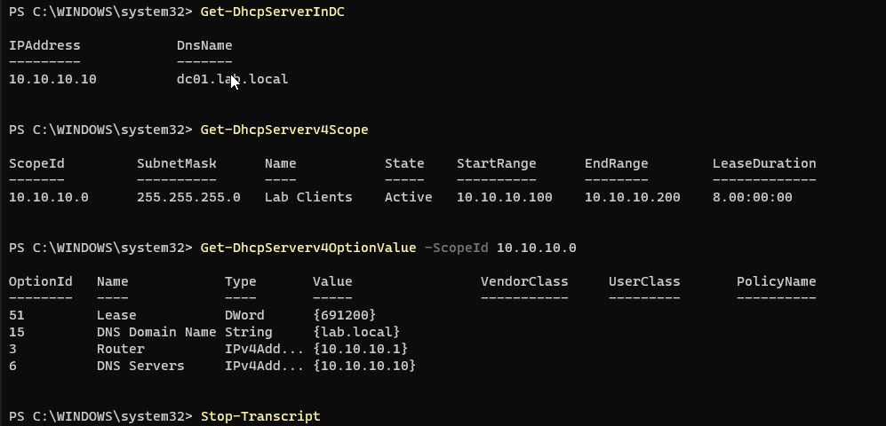

# 04: DHCP Server

## Goal
Let DC01 hand out IP settings automatically so client machines can join the network, and the domain, without manual configuration.

## How DHCP works (DORA)

| Step | What happens |
|---|---|
| **D**iscover | The new client broadcasts looking for a DHCP server |
| **O**ffer | DC01 offers an available address (e.g., 10.10.10.100) |
| **R**equest | The client requests that address |
| **A**cknowledge | DC01 confirms and starts the lease |

## Configuration (PowerShell)

```powershell
# 1. Install the role
Install-WindowsFeature DHCP -IncludeManagementTools

# 2. Authorize the server in Active Directory
Add-DhcpServerInDC -DnsName "DC01.lab.local" -IPAddress 10.10.10.10

# 3. Post-install: create DHCP security groups and clear the Server Manager alert
netsh dhcp add securitygroups
Restart-Service DHCPServer
Set-ItemProperty -Path HKLM:\SOFTWARE\Microsoft\ServerManager\Roles\12 -Name ConfigurationState -Value 2

# 4. Create the scope
Add-DhcpServerv4Scope -Name "Lab Clients" -StartRange 10.10.10.100 -EndRange 10.10.10.200 -SubnetMask 255.255.255.0 -State Active

# 5. Scope options
Set-DhcpServerv4OptionValue -ScopeId 10.10.10.0 -Router 10.10.10.1 -DnsServer 10.10.10.10 -DnsDomain lab.local
```

## Design decisions

**AD authorization.** In a domain, a Windows DHCP server won't lease addresses until it's authorized in Active Directory. This guards against **rogue DHCP servers** that could hand out bad addresses or point users at a malicious DNS server.

**Security groups.** `netsh dhcp add securitygroups` creates **DHCP Administrators** and **DHCP Users**, so DHCP management can be delegated without granting domain admin rights (least privilege).

**Scope range `.100–.200`.** Addresses `10.10.10.1–99` stay reserved for statically addressed infrastructure (gateway `.1`, DC01 `.10`, future servers and printers), preventing IP conflicts.

**Scope options**

| Option | Value | Purpose |
|---|---|---|
| 003 Router | `10.10.10.1` | Default gateway for internet access |
| 006 DNS Servers | `10.10.10.10` | **Critical:** clients must use the DC for DNS to locate the domain |
| 015 DNS Domain Name | `lab.local` | DNS suffix so short names (e.g., `DC01`) resolve |
| 051 Lease | `691200` s (8 days) | Windows default; clients renew at 50% (4 days) |

Clients receive `10.10.10.10` for DNS, not `127.0.0.1`; loopback only means "myself" on DC01.

**Lease length trade-off.** Short leases suit high-turnover networks (guest Wi-Fi) by recycling addresses quickly; longer leases suit stable office networks and reduce DHCP traffic.

## Verification

```powershell
Get-DhcpServerInDC
Get-DhcpServerv4Scope
Get-DhcpServerv4OptionValue -ScopeId 10.10.10.0
```

DC01 is authorized, the scope is **Active**, and options 3, 6, 15, and 51 are set.



The real proof came from the client. See [05: Client and Domain Join](05-client-domain-join.md), where CLIENT01 received `10.10.10.100` with every option above, without any manual configuration.
