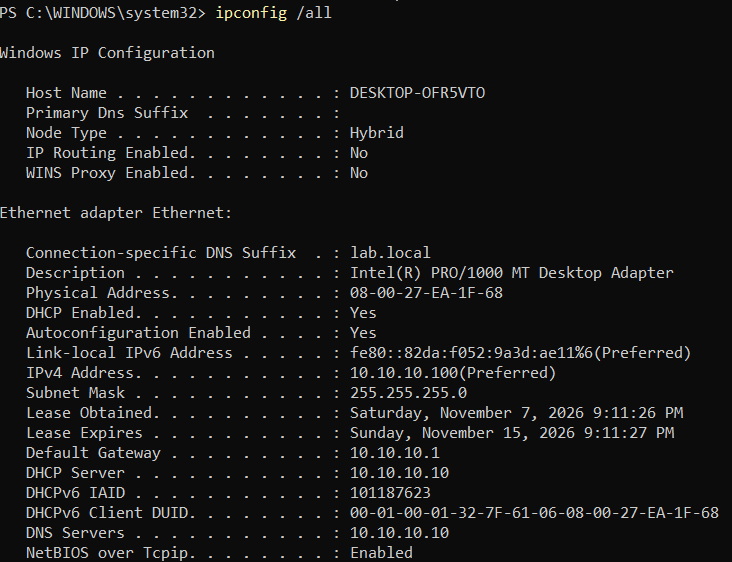
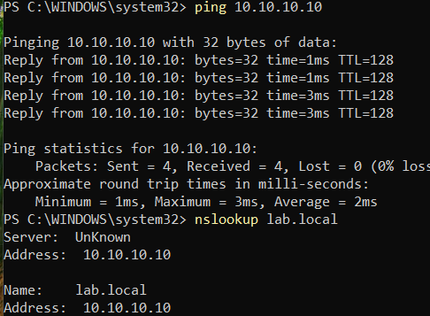
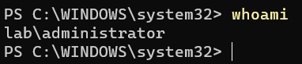
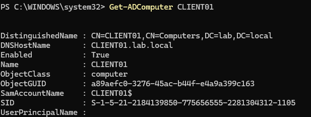
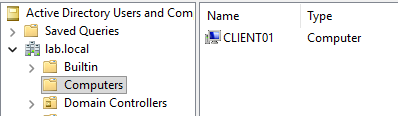

# 05: Windows 11 Client and Domain Join

## CLIENT01 Virtual Machine

| Setting | Value | Note |
|---|---|---|
| OS | Windows 11 Enterprise Evaluation (90 days) | |
| Memory | 4096 MB | Windows 11 setup requires at least 4 GB |
| CPUs | 2 | |
| Disk | 64 GB, dynamically allocated | Windows 11 minimum |
| Firmware | **UEFI, Secure Boot, TPM 2.0** | Required by Windows 11 (unlike DC01, which runs in BIOS mode) |
| Network | NAT Network `ADLab` | Same isolated lab network as DC01 |

Start-up order: **DC01 first, then the client.** Clients depend on the DC for addressing, DNS, and logins, so the DC is always first on and last off.

## Out-of-box setup
During Windows setup I chose **Set up for work or school → Sign-in options → Domain join instead** to create a local admin account rather than signing in with a Microsoft account. A local account is needed for the first login before the machine can be joined to the domain.


---

## Step 1: Confirm DHCP worked

```powershell
ipconfig /all
```



| Field | Result | Source |
|---|---|---|
| IPv4 Address | `10.10.10.100` | First address in the DHCP scope |
| Default Gateway | `10.10.10.1` | Option 003 |
| DNS Servers | `10.10.10.10` | Option 006 |
| DNS Suffix | `lab.local` | Option 015 |
| DHCP Server | `10.10.10.10` | Lease issued by DC01 |
| Lease | Obtained Nov 7, expires Nov 15 | 8-day lease (option 051) |

None of these were configured on the client by hand, which confirms the DHCP server is working end to end.

## Step 2: Confirm the client can find the domain

```powershell
ping 10.10.10.10
nslookup lab.local
```



The client reaches DC01 and resolves `lab.local` through it. This check matters because **a client locates domain controllers through DNS**; pointing at the wrong DNS server is the most common cause of domain-join failures. (`Server: UnKnown` appears because no reverse lookup zone exists yet; it doesn't affect the lab.)

---

## Step 3: Join the domain

From an elevated PowerShell on the client:

```powershell
Add-Computer -DomainName lab.local -NewName CLIENT01 -Credential LAB\Administrator -Restart
```

| Parameter | Purpose |
|---|---|
| `-DomainName lab.local` | Domain to join |
| `-NewName CLIENT01` | Renames the PC from `DESKTOP-XXXXXXX` in the same operation |
| `-Credential LAB\Administrator` | Joining requires an account with permission in the domain |
| `-Restart` | Reboots to complete the join |

**What happens during a join:** the client finds the DC through DNS, authenticates with the supplied credentials, AD creates a **computer account** for the machine, and the client and domain establish a **secure channel** (a trust relationship). When that channel breaks, users see the classic error *"The trust relationship between this workstation and the primary domain failed."*

---

## Step 4: Log in with a domain account

After the reboot: **Other user → `LAB\Administrator`**.

```powershell
whoami
```



---

## Step 5: Verify from the domain controller

```powershell
Get-ADComputer CLIENT01
```





CLIENT01 now exists in AD as a computer object (`CLIENT01$`) with its own SID, and its DNS name `CLIENT01.lab.local` is registered.

**Next:** the computer landed in the default `Computers` container. Group Policy can't be linked to that container, so the next phase creates an OU structure and moves CLIENT01 into a `Workstations` OU.
