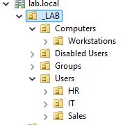
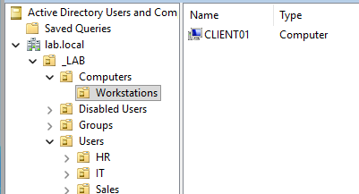
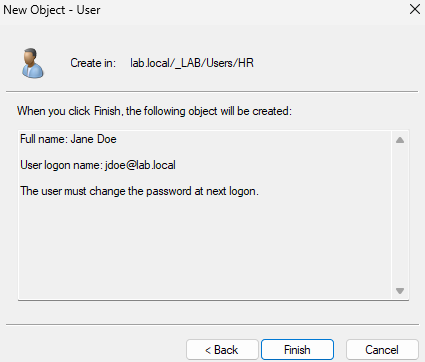
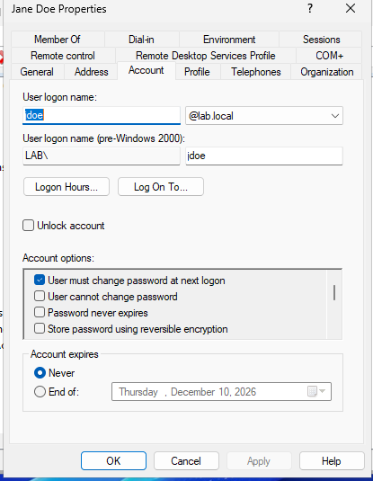
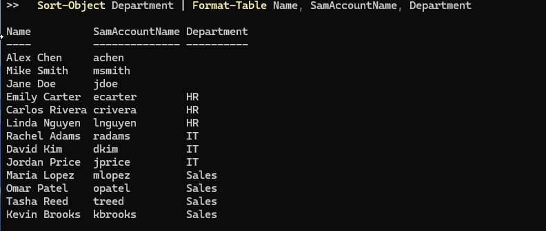

# 06: OU Structure and User Accounts

## Prep: VirtualBox Guest Additions
Installed Guest Additions on DC01 (**Devices → Insert Guest Additions CD image**, run `VBoxWindowsAdditions.exe`, reboot) and enabled **Devices → Shared Clipboard → Bidirectional**. This enables copy/paste between the host and the VM, smoother mouse input, and dynamic resizing.

---

## 1. Organizational Unit structure

An **Organizational Unit (OU)** is a folder in Active Directory used to organize users and computers. OUs serve two purposes:
- **Organization:** objects are grouped by department or function so they're easy to find and delegate.
- **Group Policy targeting:** a GPO linked to an OU applies to everything inside it.

The top-level `_LAB` OU was created in ADUC with **Protect container from accidental deletion** enabled (prevents deleting an OU full of objects with one click). The rest was scripted. See [`scripts/New-LabOUs.ps1`](../scripts/New-LabOUs.ps1).

```powershell
$Base = "OU=_LAB,DC=lab,DC=local"
"Users","Computers","Groups","Disabled Users" | ForEach-Object { New-ADOrganizationalUnit -Name $_ -Path $Base }
"HR","IT","Sales" | ForEach-Object { New-ADOrganizationalUnit -Name $_ -Path "OU=Users,$Base" }
New-ADOrganizationalUnit -Name "Workstations" -Path "OU=Computers,$Base"
```



**Distinguished names.** Every AD object has a DN, its full path. `OU=HR,OU=Users,OU=_LAB,DC=lab,DC=local` reads right to left: domain `lab.local` → `_LAB` → `Users` → `HR`.

**OUs vs. containers.** The built-in `Computers` and `Users` folders are **containers** (plain folder icon), not OUs (folder with a book icon). Group Policy can be linked to OUs but **not** to containers.

---

## 2. Moving CLIENT01 into Workstations

New domain-joined computers land in the default `Computers` container. Because GPOs can't target that container, CLIENT01 was moved into a dedicated OU:

```powershell
Get-ADComputer CLIENT01 | Move-ADObject -TargetPath "OU=Workstations,OU=Computers,OU=_LAB,DC=lab,DC=local"
```



**Best practice:** in production, `redircmp` can redirect newly joined computers to a specific OU automatically so no machine sits outside policy.

---

## 3. Creating users manually (ADUC)

Created three users by hand to learn the account options:

| User | Logon name | OU |
|---|---|---|
| Jane Doe | `jdoe` | HR |
| Mike Smith | `msmith` | Sales |
| Alex Chen | `achen` | IT |



**Two logon formats**
- **UPN:** `jdoe@lab.local` (email-style)
- **sAMAccountName / pre-Windows 2000:** `LAB\jdoe`

**Password options at creation**

| Option | Use |
|---|---|
| User must change password at next logon | Standard for new hires and resets; only the user knows the final password |
| User cannot change password | Shared/kiosk accounts |
| Password never expires | Sometimes used for service accounts; a security risk auditors flag |
| Account is disabled | Pre-staging accounts before a start date |

### The Account tab (most-used help desk screen)



| Setting | Help desk use |
|---|---|
| Unlock account | Resolve lockout tickets |
| Logon Hours / Log On To | Restrict when and from which computers a user can sign in |
| User must change password at next logon | Re-check after every password reset |
| Store password using reversible encryption | **Never enable**; stores a recoverable password |
| Account expires | Automatic cutoff for contractors and interns |

---

## 4. Bulk user creation with PowerShell

Created 10 users from a CSV with [`scripts/New-LabUsers.ps1`](../scripts/New-LabUsers.ps1) and [`scripts/users.csv`](../scripts/users.csv). The `Department` column determines each user's OU.

```powershell
cd C:\LabScripts
.\New-LabUsers.ps1
```

**Design choices**
- **No passwords in files.** The temporary password is entered at runtime with `Read-Host -AsSecureString`, so it never appears in the CSV, the script, or this repository.
- **Forced password change** at first logon for every new account.
- **Re-runnable (idempotent).** Existing usernames are skipped with a warning instead of erroring.
- **Consistent attributes.** UPN, display name, and department are set the same way every time, which manual creation can't guarantee.

### Verification

```powershell
Get-ADUser -Filter * -SearchBase "OU=Users,OU=_LAB,DC=lab,DC=local" -Properties Department |
  Sort-Object Department | Format-Table Name, SamAccountName, Department
```



13 users total. The three manually created users have no Department value because it wasn't set in the GUI, a small example of why scripted provisioning produces more consistent data.

---

## Troubleshooting note
Pasting the CSV into PowerShell along with the `notepad` command made Notepad treat the entire text as a filename. The fix was to run `notepad C:\LabScripts\users.csv` by itself, then paste the contents **into Notepad**.
